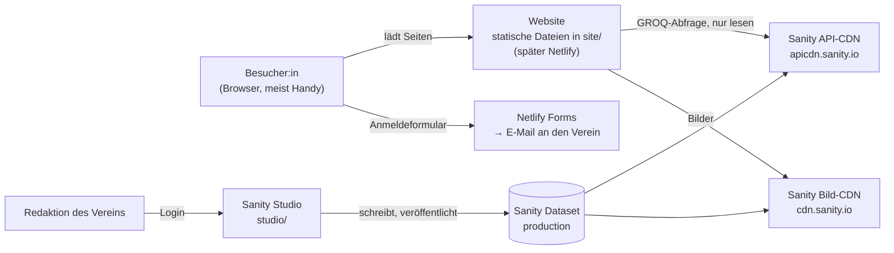

# Architektur

Die Website ist eine Sammlung statischer Dateien; Inhalte holt sie beim Aufruf direkt aus Sanity. Es gibt keinen Server und keinen Build-Schritt.

Die Website liest nur, sie hat keinen Schlüssel und kann nichts verändern. Geschrieben wird ausschließlich im Studio mit persönlichem Login.

| Baustein | Dateien | Aufgabe |
| --- | --- | --- |
| Seiten | `site/*.html` (10) | Gerüst, feste Texte, Vorbelegung (z. B. 10 Module) |
| Gemeinsames Script | `assets/js/sanity.js`, `common.js` | Abfragen, Maskierung, Bild-URLs, Rich-Text, Menü, Datumsformat, Vereins- und Akademiedaten |
| Seiten-Scripts | `assets/js/page-*.js`, `projekt-karte.js` | je Seite die Abfrage und Darstellung |
| Gestaltung | `assets/css/style.css`, `assets/fonts/` | Design-Variablen, Schriftskala, Komponenten, lokale Schriften |
| Redaktion | `studio/schemaTypes/`, `structure.js`, `sanity.config.js` | Inhaltstypen, Menü, Rechte für Einzeldokumente |
| Werkzeuge | `tools/sync_partials.py` | Kopf/Menü/Fußzeile, Module-Vorbelegung, Sitemap |
| Tests | `tests/` | Testserver wie Netlify, Mock-Sanity, Testdaten, Testlauf |

---
Teil der [technischen Dokumentation](README.md) · Stand: 11.10.2026
